<div align="center">
  
</div>
<div align="center">

<a href="https://github.com/Nad1406">
  
</a>

<p>
  
  
  
</p>

</div>

---

### `⚡ whoami --color=auto`

<table width="100%">
<tr>
<td width="32%" valign="middle">

```text
⠀⠀⠀⣸⠋⠛⢦⣄⠀⠀⠀⠀⠀⠀⠀⠀⢀⣠⠞⠋⢻⡀⠀⠀⠀
⠀⠀⠀⡟⠂⠀⠀⠈⠳⠶⠖⠒⠒⠒⠒⠶⠋⠁⠀⠀⠘⡇⠀⠀⠀
⠀⠀⢰⡇⠀⢀⠀⠀⠀⠀⠀⠀⠀⠀⠀⠀⠀⣠⡄⠀⠀⢷⠀⠀⠀
⠀⠀⢸⡇⠀⠈⠳⢦⡀⠀⠀⠀⠀⠀⠀⢀⡴⠋⠀⠀⠀⣾⠀⠀⠀
⠀⠀⣼⠗⠀⣴⣾⣟⣿⠓⠀⠀⠀⠀⠐⣿⣿⣳⣦⠀⠀⢹⡄⠀⠀
⠀⢸⡏⠀⠀⠙⠛⠟⠋⠀⠀⠀⠀⠀⠀⠈⠛⠛⠃⠀⠀⠈⢿⡀⠀
⠀⡿⠁⠀⠀⠀⠀⠀⢧⣀⣀⣠⣴⣤⣀⣀⣿⠀⠀⠀⠀⠀⠸⡇⠀
⠀⣧⠀⠀⠀⠀⠀⠀⠀⢻⣿⣿⠿⣿⣿⠏⠀⠀⠀⠀⠀⠀⢠⡇⠀
⠀⠘⣇⠀⠀⠀⠀⠀⠀⠀⣹⡛⠀⢸⡏⠀⠀⠀⠀⠀⠀⢀⡾⠅⠀
⠀⠀⢙⡷⠀⠀⠀⠀⠀⠋⠻⣿⣴⡾⠁⠀⠀⠀⠀⠀⠀⢻⡄⠀⠀
⠀⠀⡾⠁⠀⠀⠀⠀⠀⠀⠀⠀⠀⠀⠀⠀⠀⠀⠀⠀⠀⠀⢷⠀⠀
⠀⢸⡇⠀⠀⠀⠀⠀⠀⠀⠀⠀⠀⠀⠀⠀⠀⠀⠀⠀⠀⠀⠘⣇⠀
⠀⣾⠀⠀⠀⠀⠀⠀⠀⠀⠀⠀⠀⠀⠀⠀⠀⠀⠀⠀⠀⠀⠀⢽⡀
⢀⡏⠀⠀⠀⠀⠀⠀⠀⠀⠀⠀⠀⠀⠀⠀⠀⠀⠀⠀⠀⠀⠀⢸⡇
```

</td>
<td width="68%" valign="middle">

```diff
@@ NGUYỄN ANH DŨNG (Nad1406) // 14/06/2006 (20yo) @@

+ EDU      :: Y3 Computer Science (SE) @ VN-UK, Da Nang
+ FOCUS    :: Web/App Development & Vibe-Coding
+ AI_STACK :: Antigravity (Main/Cheap) + Claude & Codex (Free)

! GOAL_01  :: Giàu
! GOAL_02  :: Dev biết trade Crypto, Forex

- JOB      :: Unemployed
- HOBBIES  :: Valorant, Trade max bẩy & Ăn thịt chó

# CONTACT  :: oneone2683@gmail.com // Da Nang, Vietnam
```

</td>
</tr>
</table>

### `🎛️ system_architecture.bento`

<table width="100%">
<tr>
<td width="50%" valign="top">
<h4 align="center">🤖 AI Agents & Vibe-Coding</h4>
<p align="center">
  <br/>
  <br/>
  
</p>
<p align="center"><sub><i>"Antigravity, kết hợp Claude & Codex bản Free vì đéo có tiền."</i></sub></p>
</td>
<td width="50%" valign="top">
<h4 align="center">📈 Dev Stack & Off-Duty</h4>
<p align="center">
  
  
  
  
  
  
  
</p>
<p align="center"><sub><i>"Vào lệnh max đòn bẩy."</i></sub></p>
</td>
</tr>
</table>

### `📊 runtime_status`

<table width="100%">
<tr>
<td width="48%" valign="top">

```text
runtime_status
├─ developer   Nguyễn Anh Dũng · @Nad1406
├─ born        14/06/2006 · Da Nang, VN
├─ education   Y3 CS (SE) @ VN-UK
├─ ai_agents
│  ├─ primary    Antigravity (cheap, most used)
│  └─ secondary  Claude (Free) · Codex (Free)
├─ ambitions
│  ├─ Vibe-Coding
│  └─ Trade Crypto & Forex
└─ daily_routine
   ├─ vibe_coding  [█░░░░░░░░░] 10%
   ├─ trading      [█░░░░░░░░░] 10%
   ├─ lo.          [██████░░░░] 60% 
   └─ valorant     [██░░░░░░░░] 20%
```

</td>
<td width="52%" valign="top">

```diff
@@ [BINANCE FUTURES // NAD1406 PERPETUAL POSITIONS] @@

+ LONG   VIBE/USDT   [Isolated 100x]   ROE: +4,206.9%
+ LONG   AI_AGENT    [Cross 125x]      ROE: +1,337.0%
! HOLD   XAU/USD     [Max Leverage]    STATUS: Gồng lời
- SHORT  MANUAL_CODE [Isolated 50x]    LIQUIDATED (0.00$)
- SHORT  SLEEP_TIME  [Cross 100x]      MARGIN CALL

# PORTFOLIO_HEALTH :: 99% AI Prompting / 1% Tự gõ phím
# TRADING_RULE     :: Không cài SL, cháy thì đi ngủ
```

</td>
</tr>
</table>


---

<div align="center">
  <code>[ 🟢 SYSTEM ONLINE // </code>
  <a href="mailto:oneone2683@gmail.com"><b>oneone2683@gmail.com</b></a>
  <code> • </code>
  <a href="https://github.com/Nad1406"><b>@Nad1406</b></a>
  <code> // DA NANG, VIET NAM ]</code>
</div>
